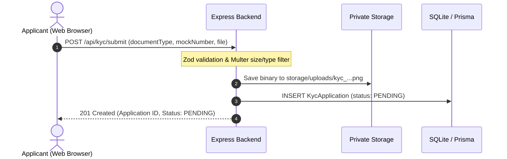
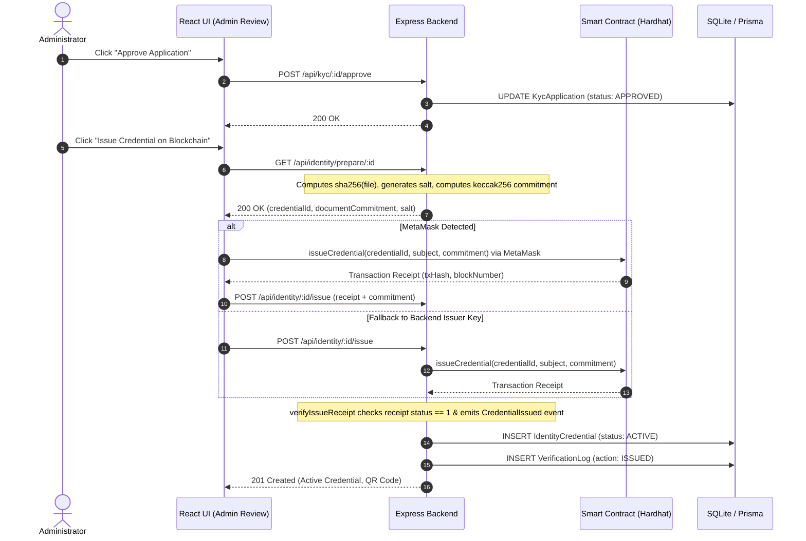
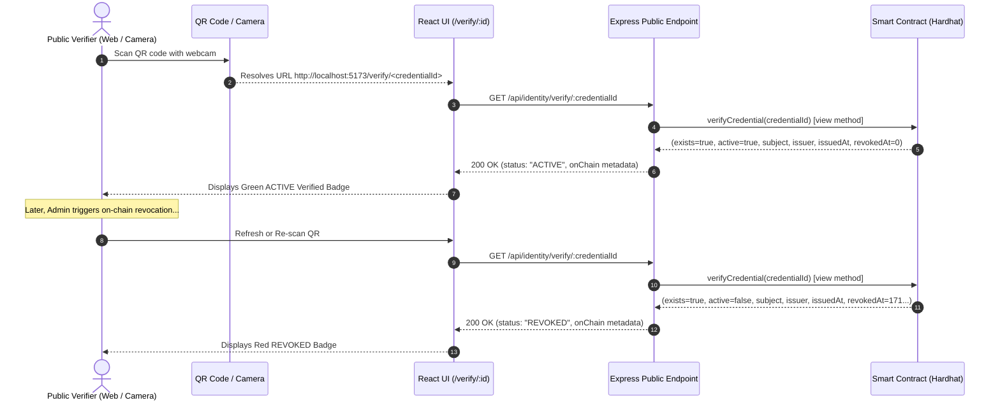

# AegisID — System Sequence Diagrams & Workflows

## 1. KYC Submission & Document Processing Flow

---

## 2. Admin Review & Dual-Mode On-Chain Issuance Flow

---

## 3. Public QR Verification & Revocation Flow

