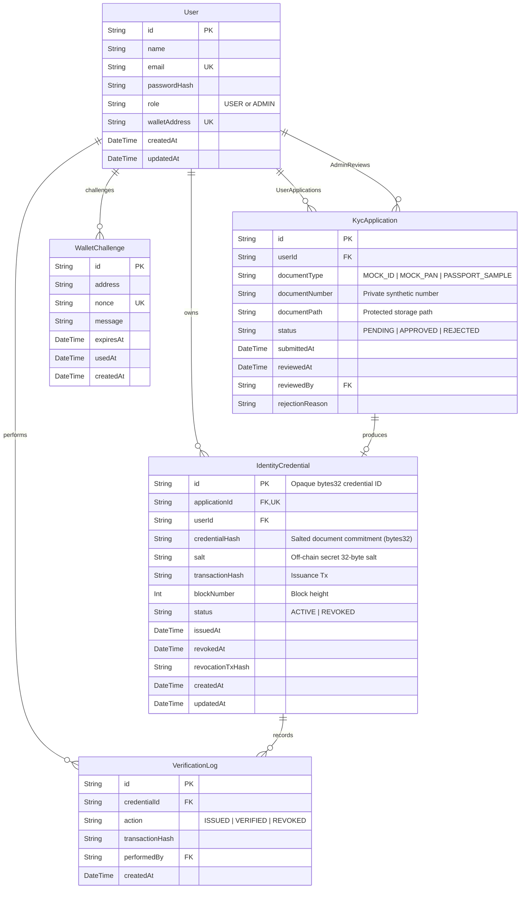

# AegisID — Database Schema & Entity-Relationship Model

The AegisID backend persistence layer is implemented using SQLite and Prisma ORM.

## Entity-Relationship Diagram

## Privacy & Security Boundaries
* **Passphrases**: Stored only as one-way bcrypt salted hashes (cost factor 10).
* **Document Files**: Uploaded synthetic documents are stored in `/storage/uploads/` outside the web root, accessible only through authenticated API streams checked for applicant or administrator ownership.
* **Document Commitments**: The `IdentityCredential.credentialHash` is calculated as `keccak256(sha256(file) + ":" + salt)`. Only this hash is sent to the blockchain.
* **Zero PII on Ledger**: The smart contract never receives or stores names, emails, raw document numbers, or file contents.
